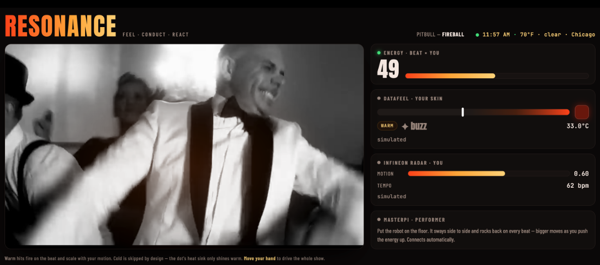
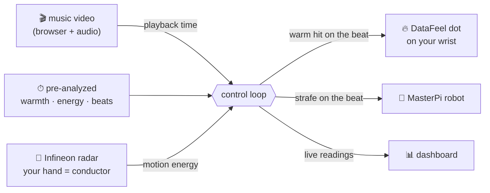

<h1 align="center">🔥 RESONANCE 🧊</h1>

<p align="center"><b>Feel the music. Conduct it with your hand. Watch a robot dance to it.</b></p>

<p align="center">
  A music video becomes a full-body experience — a wearable <b>haptic</b> dot heats to the beat,
  a <b>60&nbsp;GHz radar</b> turns your hand into the conductor, and a <b>robot</b> dances along.
</p>

<p align="center">
  
  
  
  
</p>

<p align="center">
  <a href="https://youtu.be/7JQqd8YsqEc">
    
    <br><b>▶ Watch the 90-second demo</b>
  </a>
</p>

---

## What it does

**RESONANCE turns a music video into something you feel, control, and perform with.** A DataFeel
dot on your wrist **warms to the beat**, an Infineon radar lets you **conduct the intensity by
moving your hand**, and a Hiwonder MasterPi robot **dances to the same beat** — a live dashboard
shows every device reacting in real time.

**The problem it solves:** screens only reach your eyes and ears. RESONANCE adds **touch, motion,
and a physical performer**, so you don't just watch a song — you feel it on your skin and shape it
with your hand.

<p align="center"></p>

---

## How it works

The song is **pre-analyzed once** into a timeline of scene warmth, visual energy, and real audio
beats. At runtime the browser plays it and reports its position; a control loop reads that,
folds in your live hand motion from the radar, and drives the dot and robot — all in sync.



| Device | Role | What you experience |
|---|---|---|
| 🎬 **Video** | the song — beat, colour, energy | Fireball plays with a mood-reactive glow |
| 🔥 **DataFeel dot** | *feel it* | warms in swells, flashes/buzzes on every beat |
| 📡 **Infineon radar** (60 GHz) | *conduct it* | move your hand → the whole show intensifies |
| 🤖 **MasterPi robot** | *watch it perform* | sways to the beat, harder as the energy climbs |

---

## ✨ Features

- **Feel the beat** — closed-loop thermal control drives the dot to a target skin temperature in sync with the music.
- **Conduct with your hand** — contactless 60 GHz radar reads your motion; raise the energy and everything responds.
- **A dancing robot** — a MasterPi strafes to the beat over Wi-Fi, with auto-reconnect and a hard **STOP**.
- **Live VJ dashboard** — every device's readings stream to the browser over Server-Sent Events.
- **Real-time context** — a live clock, local weather, and the song's live YouTube view count in the header. Fetches go **directly by default**, or through **Bright Data** if a proxy is configured (`BRIGHTDATA_PROXY`).
- **One-command launch** — `./run_internet.sh` (feel + conduct) or `./run_robot.sh` (add the robot).

---

## 🚀 Quick start

```bash
python3 -m venv .venv && source .venv/bin/activate
pip install numpy scipy opencv-python mss pyserial yt-dlp
# + the Infineon radar SDK wheel and the DataFeel SDK (see Hardware)

yt-dlp -f "bv*[vcodec^=avc][height<=720]+ba" --merge-output-format mp4 -o media/fireball.mp4 "<youtube-url>"
python analyze.py media/fireball.mp4      # → warmth / energy / beat timeline

./run_internet.sh     # DataFeel + Infineon + video   → http://localhost:8777
./run_robot.sh        # all three, via the robot's Wi-Fi hotspot
```

Open **http://localhost:8777**, click **Start**, wear the dot, move your hand.

---

## 🧰 Hardware

- **DataFeel Dot** — wearable heat / cold / vibration / LED over USB. (Needs its own power brick.)
- **Infineon XENSIV BGT60TR13C** — 60 GHz FMCW radar; used here for contactless hand-motion sensing.
- **Hiwonder MasterPi** — Raspberry Pi mecanum-wheel robot; dances over SSH. (Drive motors need the battery.)

## 🗂 Code

| File | Role |
|---|---|
| `resonance.py` / `resonance.html` | server + control loop, and the live dashboard |
| `analyze.py` | pre-analyzes a song into warmth / energy / beats |
| `thermoscene.py` | device drivers (`SceneReader`, `RadarBreath`, `Dots`) |
| `dance_daemon.py` / `robot_dance.py` | on-robot dancers (live + autonomous) |

## 🐛 War stories (the fun part)

- The MasterPi's "Wi-Fi kept dropping" — it was actually a `bruno/robot_server.py` service **pegging the Pi's CPU**, starving the network stack. Ping worked, SSH timed out. Killing it fixed everything.
- The robot wouldn't move on USB-C: the drive motors **brown out the Pi** — they need the battery.
- One DataFeel dot can't stay cold — the Peltier saturates its tiny heat sink in ~15 s. So RESONANCE is **warm-only**, fired as short hits that let the sink recover.

---

## 🙏 Credits & starting points

**Hardware + their SDKs** (the device drivers build on these):
- **DataFeel Dot** — [DataFeel/devkit-samples](https://github.com/DataFeel/devkit-samples) (Python SDK for heat/LED/vibration over Modbus).
- **Infineon XENSIV BGT60TR13C** — Infineon Radar Development Kit SDK (`ifxradarsdk`) for the 60 GHz FMCW radar.
- **Hiwonder MasterPi** — Hiwonder's on-robot SDK (`common.mecanum`, `ros_robot_controller_sdk`) for the wheels/arm.

**APIs & libraries:**
- **Open-Meteo** + **ip-api.com** — weather & geolocation (fetched directly; optional **Bright Data** proxy path is wired but not keyed).
- **yt-dlp** — fetch the music video · **OpenCV / NumPy / SciPy** — scene colour, radar DSP, and audio beat detection.
- Python `http.server` + Server-Sent Events for the dashboard.

**Content:** the demo song is **Pitbull — "Fireball"** (YouTube), used as playback material.

**Written for this project (new work):** `resonance.py`, `resonance.html`, `analyze.py`, the device
drivers in `thermoscene.py` (`SceneReader`, `RadarBreath`, `Dots`), the dance code
(`dance_daemon.py`, `robot_dance.py`), and `realtime.py` — i.e. all the glue that makes the three
devices move together to the music.

---

<p align="center"><i>Feel it. Conduct it. Watch it dance.</i></p>
